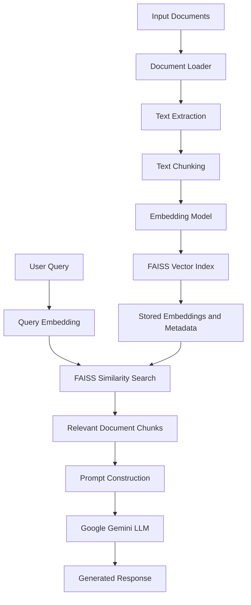

# Personal RAG AI Assistant

An AI-powered personal knowledge assistant that uses **Retrieval-Augmented Generation (RAG)** to search through personal documents, retrieve relevant information using semantic similarity, and generate context-aware responses using a Large Language Model (LLM).

The application combines document processing, text chunking, semantic embeddings, FAISS vector search, and Google Gemini to provide answers grounded in the information available in your documents.

---

## Table of Contents

1. [Overview](#overview)
2. [What is Retrieval-Augmented Generation (RAG)?](#what-is-retrieval-augmented-generation-rag)
3. [Why RAG?](#why-rag)
4. [System Architecture](#system-architecture)
5. [Project Workflow](#project-workflow)
6. [Tech Stack](#tech-stack)
7. [Project Structure](#project-structure)
8. [Core Components](#core-components)
9. [Installation and Setup](#installation-and-setup)
10. [Environment Configuration](#environment-configuration)
11. [Running the Application](#running-the-application)
12. [Example Usage](#example-usage)
13. [Key Concepts](#key-concepts)
14. [Future Improvements](#future-improvements)
15. [Contributing](#contributing)
16. [License](#license)

---

## 1. Overview

The Personal RAG AI Assistant is designed to make information stored across personal documents easily accessible through natural-language queries.

Instead of manually searching through multiple files, users can provide documents to the application and ask questions about their contents.

The application follows a RAG pipeline:

- **Document Ingestion:** Loads information from PDF, TXT, CSV, and SQL files.
- **Text Processing:** Splits large documents into smaller, manageable chunks.
- **Embedding Generation:** Converts text chunks into numerical vector representations using Sentence Transformers.
- **Vector Storage:** Stores embeddings in a FAISS index for efficient similarity-based retrieval.
- **Semantic Retrieval:** Retrieves the most relevant document chunks based on the user's query.
- **Response Generation:** Passes the retrieved context to Google Gemini to generate a relevant and context-aware response.

## 2. What is Retrieval-Augmented Generation (RAG)?

Retrieval-Augmented Generation is an approach that combines information retrieval with Large Language Models.

A conventional LLM generates responses based primarily on information learned during training. However, it may not know about private documents, recently updated information, or domain-specific knowledge.

RAG addresses this limitation by retrieving relevant information from an external knowledge source and providing it to the LLM as additional context.

The process consists of two major stages:

### A. Indexing Pipeline

This stage prepares documents so that they can be searched efficiently.

1. Load documents from supported file formats.
2. Split documents into smaller chunks.
3. Generate vector embeddings for each chunk.
4. Store embeddings and their associated text in a vector database or index.

### B. Retrieval and Generation Pipeline

This stage runs whenever a user submits a query.

1. Convert the user's query into an embedding.
2. Search the FAISS index for semantically similar document chunks.
3. Retrieve the most relevant chunks.
4. Construct a prompt containing the query and retrieved context.
5. Pass the prompt to the LLM.
6. Generate a response grounded in the retrieved information.

## 3. Why RAG?

Some of the limitations of relying exclusively on an LLM include:

- **Limited access to private information:** The model does not automatically know the contents of your personal documents.
- **Knowledge limitations:** The model's training data may not contain the information you need.
- **Hallucinations:** An LLM can generate plausible-sounding but unsupported information.
- **Lack of source-specific context:** General-purpose models may not provide answers tailored to your documents.

RAG helps address these limitations by retrieving relevant external information before generating a response.

**Key benefits:**

- Search across multiple personal documents.
- Retrieve information using semantic similarity rather than relying exclusively on exact keyword matching.
- Provide relevant context to an LLM before response generation.
- Keep the document collection separate from the LLM's original training data.
- Update the knowledge base by processing additional documents.

*Note: RAG can reduce unsupported responses, but it does not completely eliminate hallucinations. Response quality depends on retrieval quality, document relevance, and the LLM.*

## 4. System Architecture

The application follows a two-stage architecture: document indexing and query processing.

### High-Level Architecture



### Architecture Explanation

**Document Indexing**

Documents are loaded and converted into text-based representations. The extracted text is split into chunks, and each chunk is transformed into a vector embedding.

These embeddings are stored in FAISS alongside their corresponding text metadata.

**Query Processing**

When a user submits a question, the application generates an embedding for the query and searches the FAISS index.

The retrieved chunks are combined into a context prompt and passed to the LLM, which generates the final answer.

## 5. Project Workflow

### Step 1: Document Ingestion

The application accepts different document formats:

| File format | Processing approach |
|---|---|
| PDF | PyMuPDFLoader |
| TXT | TextLoader |
| CSV | CSVLoader |
| SQL | TextLoader |

Each loader extracts text and converts it into LangChain Document objects.

### Step 2: Text Chunking

Large documents are divided into smaller chunks using `RecursiveCharacterTextSplitter`.

The current configuration is:

| Parameter | Value |
|---|---:|
| Chunk size | 1000 |
| Chunk overlap | 200 |

**Why chunking?**

- Large documents can exceed the context window available to an LLM.
- Smaller chunks improve the granularity of retrieval.
- Overlapping chunks help preserve context between adjacent text segments.

### Step 3: Embedding Generation

The application uses the Sentence Transformers model:

`all-MiniLM-L6-v2`

An embedding model converts text into numerical vectors that represent semantic information.

For example, two sentences with similar meanings can have embeddings that are relatively close in vector space, even if they use different words.

These vectors are subsequently used for similarity-based retrieval.

### Step 4: Vector Storage using FAISS

The application uses **Facebook AI Similarity Search (FAISS)** to store and search vector embeddings.

The current implementation uses:

`faiss.IndexFlatL2`

This index performs exact nearest-neighbour search using squared Euclidean (L2) distance.

A lower L2 distance indicates that two vectors are closer under this distance metric.

The corresponding text chunks are maintained as metadata so that retrieved vector indices can be mapped back to their original text.

### Step 5: Semantic Retrieval

When a user submits a query:

1. The query is converted into an embedding using the same embedding model.
2. FAISS searches for the nearest vectors.
3. The corresponding document chunks are retrieved.
4. The retrieved text is prepared as context for the LLM.

### Step 6: LLM Integration

The retrieved context and user query are passed to Google Gemini.

The LLM is instructed to answer using the retrieved information and acknowledge when the context does not contain the required answer.

This helps keep responses relevant to the indexed knowledge base.

---

## 6. Tech Stack

| Technology | Purpose |
|---|---|
| Python | Core programming language |
| LangChain | Document processing and LLM integration |
| Sentence Transformers | Semantic embedding generation |
| all-MiniLM-L6-v2 | Text embedding model |
| FAISS | Vector indexing and similarity search |
| Google Gemini | Context-aware response generation |
| PyMuPDF | PDF text extraction |
| python-dotenv | Environment variable management |
| NumPy | Numerical and vector operations |
| Pickle | Persistence of metadata |
| uv | Python dependency and environment management |
| Git & GitHub | Version control and project hosting |

---

## 7. Project Structure

The following represents the intended organization of the project. Adjust filenames if your local implementation differs.

```text
Personal-RAG-AI-Assistant/
│
├── data/
│   ├── PDF_files/
│   ├── text_files/
│   ├── CSV_files/
│   └── SQL_files/
│
├── src/
│   ├── __init__.py
│   ├── data_loader.py
│   │
│   └── rag/
│       ├── __init__.py
│       ├── embedding.py
│       ├── vectorstore.py
│       └── search.py
│
├── faiss_store/
│   ├── faiss.index
│   └── metadata.pkl
│
├── app.py
├── .env
├── .env.example
├── .gitignore
├── pyproject.toml
├── uv.lock
└── README.md
```

### Directory Description

- `data/`: Contains the documents used as the knowledge source.
- `src/data_loader.py`: Responsible for loading supported document formats.
- `src/rag/embedding.py`: Handles document chunking and embedding generation.
- `src/rag/vectorstore.py`: Manages FAISS indexing, persistence, and similarity search.
- `src/rag/search.py`: Integrates retrieval with the LLM to generate responses.
- `faiss_store/`: Stores the generated FAISS index and metadata locally.
- `app.py`: Application entry point.
- `.env`: Stores API credentials and environment-specific configuration.
- `pyproject.toml`: Defines project dependencies and configuration.
- `uv.lock`: Maintains locked dependency versions.

---

## 8. Core Components

### A. Document Loader

Responsible for identifying supported files, extracting their contents, and converting them into LangChain Document objects.

The application uses different loaders depending on the file extension.

### B. Embeddings Pipeline

Responsible for:

- Splitting documents into smaller chunks.
- Loading the Sentence Transformer embedding model.
- Generating vector representations for the document chunks.

### C. FAISS Vector Store

Responsible for:

- Creating a FAISS index.
- Adding document embeddings to the index.
- Maintaining the corresponding text metadata.
- Saving and loading the index.
- Performing similarity searches.

### D. RAG Search

Responsible for:

- Accepting user queries.
- Retrieving relevant document chunks.
- Constructing the context-aware prompt.
- Invoking Google Gemini.
- Returning the generated response.

---

## 9. Installation and Setup

### Prerequisites

Ensure the following are installed:

- Python 3.12 or compatible version.
- Git.
- uv package manager.
- A Google Gemini API key.

### Step 1: Clone the Repository

```bash
git clone https://github.com/YOUR_USERNAME/Personal-RAG-AI-Assistant.git
```

Navigate into the project directory:

```bash
cd Personal-RAG-AI-Assistant
```

### Step 2: Create a Virtual Environment

```bash
uv venv
```

Activate it on Windows PowerShell:

```powershell
.venv\Scripts\Activate.ps1
```

### Step 3: Install Dependencies

If the project contains `pyproject.toml` and `uv.lock`:

```bash
uv sync
```

Alternatively, install dependencies using pip if a requirements file is provided:

```bash
pip install -r requirements.txt
```

### Step 4: Configure Environment Variables

Create a `.env` file in the project root.

Add your Google Gemini API key:

```env
GOOGLE_API_KEY=your_google_api_key
```

Never commit your actual API key to GitHub.

---

## 10. Environment Configuration

The application uses environment variables to keep sensitive configuration separate from the source code.

Example:

```python
import os
from dotenv import load_dotenv

load_dotenv()

google_api_key = os.getenv("GOOGLE_API_KEY")
```

The `.env` file should remain excluded from version control.

A safe `.gitignore` configuration:

```gitignore
.env
.env.*
!.env.example

.venv/
__pycache__/
*.pyc

faiss_store/

.ipynb_checkpoints/
```

You can provide a `.env.example` file containing placeholder values:

```env
GOOGLE_API_KEY=your_google_api_key
```

---

## 11. Running the Application

After installing the dependencies and configuring the environment variables, run:

```bash
python app.py
```

The application should:

1. Load the configured document collection.
2. Generate embeddings and build the FAISS index if it does not already exist.
3. Load the existing FAISS index if it is available.
4. Initialize the Google Gemini integration.
5. Process queries using the retrieval and generation pipeline.

*The exact command and interactive query interface depend on how `app.py` is implemented.*

---

## 12. Example Usage

Suppose your knowledge base contains:

- Technical documentation.
- Programming notes.
- Research papers.
- Personal project documentation.
- Other PDF, TXT, CSV, and SQL files.

You can ask questions such as:

```text
What are the key concepts discussed in my Python notes?
```

```text
Summarize the main ideas from the uploaded research paper.
```

```text
What information is available about a particular project?
```

```text
Explain the SQL concepts covered in my documents.
```

The system retrieves relevant document chunks and uses them as context for generating an answer.

*These are illustrative queries; actual answers depend on the documents indexed in the knowledge base.*

---

## 13. Key Concepts

A few important concepts behind this implementation:

| Concept | Explanation |
|---|---|
| RAG | Combines information retrieval with LLM-based generation. |
| Tokenization | Breaks text into tokens that models can process. |
| Chunking | Divides large documents into smaller text segments. |
| Embeddings | Numerical representations of text. |
| Semantic Search | Finds information based on meaning and similarity. |
| Vector Index | Organizes vectors to support similarity searches. |
| FAISS | Library for efficient similarity search over dense vectors. |
| Metadata | Stores additional information associated with document chunks. |
| Context Window | The amount of input and output a model can process in a request. |
| Hallucination | Generated information that is unsupported or factually incorrect. |

---

## 14. Future Improvements

The project can be extended with several advanced RAG capabilities:

- **Hybrid Search:** Combine semantic vector search with keyword-based retrieval.
- **Advanced Retrieval:** Implement query rewriting, multi-query retrieval, and contextual retrieval.
- **Reranking:** Reorder retrieved chunks using a cross-encoder or reranking model.
- **Conversational Memory:** Maintain conversation history to support follow-up questions.
- **Source Citations:** Display the original document name and page number associated with retrieved information.
- **Streaming Responses:** Stream LLM responses instead of waiting for the complete output.
- **Evaluation:** Measure retrieval precision, recall, answer relevance, and faithfulness.
- **Advanced RAG:** Explore query decomposition, multi-step retrieval, and agentic RAG workflows.
- **User Interface:** Develop a web-based interface for document uploads and conversational interaction.
- **Scalable Storage:** Explore persistent vector databases and more advanced indexing strategies.

---

## 15. Contributing

Contributions, suggestions, and improvements are welcome.

To contribute:

1. Fork the repository.
2. Create a new feature branch.
3. Implement your changes.
4. Commit your changes with a descriptive commit message.
5. Open a pull request.

---

## 16. License

No open-source license has been selected yet.

If you intend to allow others to reuse, modify, and distribute this project, consider adding an appropriate license such as the MIT License.

---

## Author

**Sai Akshay Gandlapalli**

GitHub: [YOUR_GITHUB_PROFILE](https://github.com/YOUR_USERNAME)

---

*Built to explore and implement Retrieval-Augmented Generation, semantic search, vector databases, and LLM-powered applications.*
